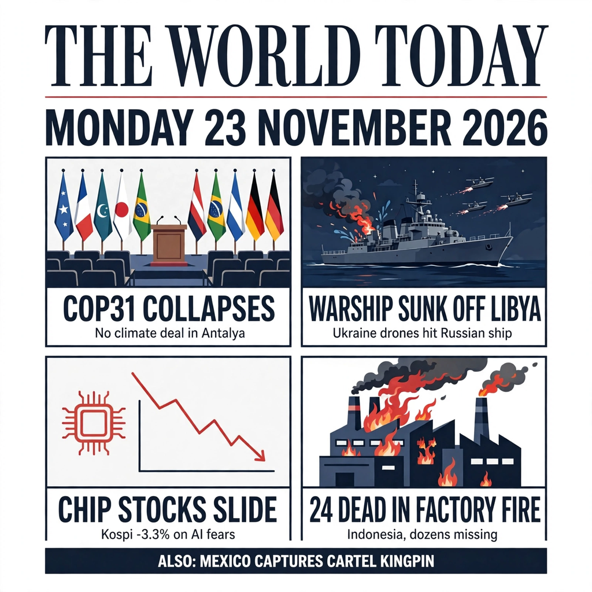

# The World Today — 23 November 2026

A make.fun bounty entry for **news-image-20261123**: one image summing up the
world's news of Monday 23 November 2026.

## The day's news

- **COP31 collapses** — UN climate talks in Antalya end with no deal.
- **Warship sunk off Libya** — Ukrainian sea drones hit a Russian ship.
- **Chip stocks slide** — Kospi −3.3% on AI-spending fears.
- **24 dead in factory fire** — Indonesia, dozens still missing.
- Also: Mexico captures a cartel kingpin.

## The program

`main.ts` (Node 22, standard library only) copies `entry.png` to the output
directory as `entry.png`. It uses no network and writes the same bytes on
every run:

    mkdir -p out && MAKEFUN_OUTPUT_DIR=out node main.ts

## License

MIT — see [LICENSE](LICENSE).
